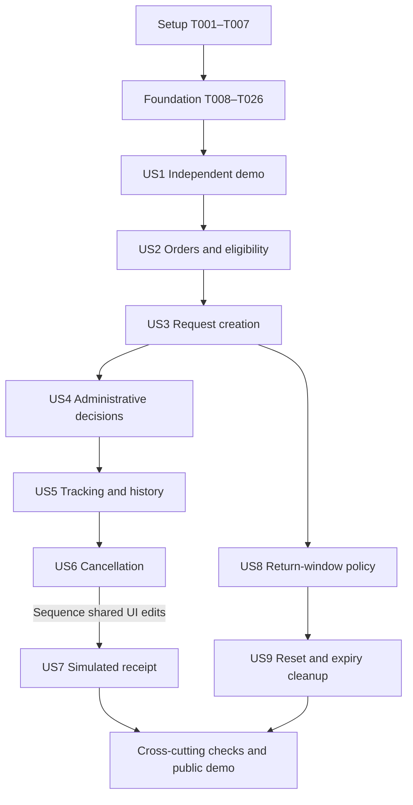

# Tasks: Order Returns Manager MVP

**Input**: Design documents from `/specs/001-manage-order-returns/`

**Prerequisites**: [plan.md](plan.md), [spec.md](spec.md), [research.md](research.md),
[data-model.md](data-model.md), [HTTP contract](contracts/http.md),
[UI contract](contracts/ui.md), [quickstart.md](quickstart.md), and constitution v1.0.0.

**Tests**: Included because the constitution requires domain/concurrency/history coverage
and the design's quickstart explicitly specifies unit, PostgreSQL integration, contract
and Playwright verification. Write each story's tests first, observe the relevant missing
behavior fail, then implement and rerun; do not treat missing test setup as a passing check.

**Organization**: One setup phase, one shared foundation, nine story phases in the exact
P1/P2 priority order of spec.md, then cross-cutting verification/deployment. This document
defines future work; every task remains unchecked and no application test result is claimed.

## Format: `[ID] [P?] [Story] Description`

- IDs are sequential execution identifiers; dependencies named in text are mandatory.
- `[P]` means disjoint files and no dependency on another task in the same parallel batch,
  after that batch's stated prerequisites; it does not authorize skipping prerequisite phases.
- `[US1]` through `[US9]` match the specification's story numbers.
- Schema and shared-file changes are sequential. All tasks include repository-relative paths.

## Path Conventions

Single Next.js project: `src/`, `prisma/`, `public/`, `tests/`, `scripts/` at repository root.
SDD artifacts remain in `specs/001-manage-order-returns/`. Preserve existing catalog sources.
Paths in this file describe files to implement, not files already created. A planned
migration directory may use its actual generated timestamp while preserving its purpose.

## Phase 1: Setup (Shared Infrastructure)

**Purpose**: Initialize the single Next.js package and executable local tooling while preserving existing catalog and SDD files.

- [X] T001 Initialize the modular Next.js 16/React 19 App Router package with pinned TypeScript, Tailwind 4, Prisma 7 client/CLI/pg adapter, Zod 4, Vitest and Playwright dependencies in `package.json`, `package-lock.json`, `next.config.ts` and `src/app/layout.tsx`; set Node 22.12+ in `.nvmrc` and never overwrite `catalog/` or `specs/`.
- [X] T002 Configure strict TypeScript, ESLint, and the dev/build/start/lint/typecheck/test/db/cleanup script contract from quickstart in `tsconfig.json`, `eslint.config.mjs` and `package.json`; assign explicit future script paths so each subsequent task can fill its implementation. Depends on T001.
- [X] T003 [P] Define documented server-only DATABASE_URL, DATABASE_URL_UNPOOLED, TEST_DATABASE_URL, DEMO_TOKEN_SECRET, APP_ORIGIN and CRON_SECRET validation in `.env.example`, `.gitignore` and `src/lib/env.ts`; prevent secret values reaching client bundles. After T002.
- [X] T004 [P] Configure unit/integration/contract projects and a dedicated PostgreSQL target guard in `vitest.config.ts` and `tests/helpers/database-target.ts`; refuse production/development database reuse for destructive fixtures. After T002.
- [X] T005 [P] Configure Chromium E2E runs at 360/1280 px and reusable isolated browser-context fixtures in `playwright.config.ts` and `tests/e2e/fixtures.ts`; define the managed test-server command without adding a public clock override. After T002.
- [X] T006 [P] Provide PostgreSQL 17 development and separate test databases with reproducible startup/health checks in `compose.yaml` and `scripts/init-test-database.sql`; keep credentials local and no real customer data. After T002.
- [X] T007 [P] Implement approved Order workspace CSS tokens, spacing, five semantic status pairs, self-hosted IBM Plex Sans with license notice and 16/24/32 px type scale in `src/app/globals.css`, `src/app/fonts.ts` and `public/fonts/OFL.txt`; use USD and English conventions from `contracts/ui.md`. After T002.

**Checkpoint**: Verify the phase outputs and executable prerequisites before continuing.

---

## Phase 2: Foundational (Blocking Prerequisites)

**Purpose**: Create shared persistence, guards and test fixtures before any user-story implementation. No real authentication or business-role authorization is introduced.

**Critical gate**: Complete this entire phase and its checks before user-story implementation.

- [X] T008 Define VisitorContext, DemoEnvironment in `prisma/schema.prisma` with these verbatim field/constraint contracts: VisitorContext: "id UUID; tokenHash unique text; createdAt timestamptz; lastEnvironmentExpiredAt timestamptz nullable"; "Anonymous provisioning/quota identity; no personal data or role"; DemoEnvironment: "id UUID; visitorId unique UUID; capabilityHash unique text; generation integer; lastActivityAt, createdAt timestamptz"; "One active environment per visitor context; generation starts at 1; access deadline is lastActivityAt + 168 hours". Schema edits run sequentially, following the previous schema task; retain all previously defined models.
- [X] T009 Define Product, Customer in `prisma/schema.prisma` with these verbatim field/constraint contracts: Product: "id integer; sku unique text; name, description, category, imagePath, imageAlt text; priceMinor bigint; currency USD"; "Ten immutable shared fictional records; nonnegative price; static images"; Customer: "id UUID; environmentId UUID; generation integer; displayName text"; "Unique (environmentId, generation, id); at least two profiles per seed". Schema edits run sequentially, following the previous schema task; retain all previously defined models.
- [X] T010 Define Order, OrderItem in `prisma/schema.prisma` with these verbatim field/constraint contracts: Order: "id UUID; environmentId UUID; generation integer; customerId UUID; displayNumber text; orderedAt timestamptz; status enum; deliveredAt timestamptz nullable"; "Composite customer reference in same environment/generation; unique displayNumber within generation"; OrderItem: "id UUID; environmentId UUID; generation integer; orderId UUID; productId integer; purchasedQuantity integer; purchasePriceMinor bigint"; "Positive quantity; nonnegative purchase price; unique (environmentId, generation, orderId, productId)". Schema edits run sequentially, following the previous schema task; retain all previously defined models.
- [X] T011 Define ReturnRequest, ReturnItem in `prisma/schema.prisma` with these verbatim field/constraint contracts: ReturnRequest: "id UUID; environmentId UUID; generation integer; orderId UUID; customerId UUID; displayNumber text; reason text; status enum; createdAt, updatedAt timestamptz; rejectionReason text nullable; version integer"; "Composite order/customer association; nonblank reason; rejection reason nonblank iff rejected; version starts at 1 and increments on transition"; ReturnItem: "id UUID; environmentId UUID; generation integer; requestId UUID; orderItemId UUID; orderId UUID; quantity integer"; "Positive quantity; unique request/item pair; composite references force same order, environment and generation". Schema edits run sequentially, following the previous schema task; retain all previously defined models.
- [X] T012 Define ReturnPolicy in `prisma/schema.prisma` with these verbatim field/constraint contracts: ReturnPolicy: "environmentId UUID primary key; windowDays integer; updatedAt timestamptz"; "One policy per environment; positive integer; starts at 30; reset replaces value". Schema edits run sequentially, following the previous schema task; retain all previously defined models.
- [X] T013 Define HistoryEvent in `prisma/schema.prisma` with these verbatim field/constraint contracts: HistoryEvent: "id UUID; environmentId UUID; generation integer; requestId UUID; sequence integer; eventType enum; occurredAt timestamptz; actorKind CUSTOMER or ADMIN; actorCustomerId UUID nullable; reason text nullable"; "Unique request/sequence; customer actor required for CREATED/CANCELLED; administrator actor for decisions/receipt; rejection event retains reason". Schema edits run sequentially, following the previous schema task; retain all previously defined models.
- [X] T014 Define OperationReceipt, ProvisionReceipt in `prisma/schema.prisma` with these verbatim field/constraint contracts: OperationReceipt: "id UUID; environmentId UUID; inputGeneration integer; operationId UUID; operationKind enum; payloadHash text; actorScope text; resultJson jsonb; statusCode integer; createdAt timestamptz"; "Unique (environmentId, inputGeneration, operationId); survives reset; no foreign key to reset-deleted request; result contains safe minimal response"; ProvisionReceipt: "visitorId UUID; operationId UUID; nonce text; resultEnvironmentId UUID; createdAt timestamptz"; "Unique visitor/operation; HMAC-derived capability recovery for lost provisioning responses; no raw token storage". Schema edits run sequentially, following the previous schema task; retain all previously defined models.
- [X] T015 Define RateBucket, CapacityGuard in `prisma/schema.prisma` with these verbatim field/constraint contracts: RateBucket: "visitorHash text; category enum; windowStart timestamptz; attempts integer; expiresAt timestamptz"; "Composite primary key on visitorHash/category/windowStart; survives demo reset; durable independent transaction"; CapacityGuard: "id singleton integer"; "Lock serializes environment admission; count unexpired rows after reclaim; no customer-visible state". Schema edits run sequentially, following the previous schema task; retain all previously defined models.
- [X] T016 Generate and review `prisma/migrations/202610210001_initial/migration.sql` and `prisma.config.ts`: enforce composite environment/generation/order/customer foreign keys, positive quantities/window/generation/version, nonnegative prices, nonblank reasons, actor/rejection checks, unique request/item and request/sequence keys; add all data-model indexes and exact enums PROCESSING/SHIPPED/DELIVERED, PENDING/APPROVED/REJECTED/CANCELLED/RECEIVED, CREATED/APPROVED/REJECTED/CANCELLED/RECEIVED, CUSTOMER/ADMIN, CREATE_RETURN/APPROVE/REJECT/CANCEL/RECEIVE/UPDATE_POLICY/RESET and MUTATION_MINUTE/RESET_HOUR/CREATE_ENVIRONMENT_HOUR. Use the direct URL and explicitly load local CLI env. Depends on T015.
- [X] T017 Implement one module-scoped Prisma 7 pg-adapter client, server-only access, a maximum-five driver pool, deployment pool lifecycle handling and finite connection/transaction timeouts in `src/lib/prisma.ts`; use pooled runtime URL and no per-request disconnect. Depends on T016 and T003.
- [X] T018 [P] Implement typed safe domain errors, uniform response envelopes, correlation IDs, no-store/Vary headers and redacted technical logging in `src/lib/errors.ts`, `src/lib/http.ts` and `src/lib/logger.ts`; preserve 400/404/409/500 meanings and contract-specific 403/429/503, never log cookie values or free-text reasons. After setup.
- [X] T019 [P] Implement an injectable server/database clock and America/Bogota date-only arithmetic boundaries in `src/lib/clock.ts` and `src/lib/calendar.ts`; production time must be obtained after acquiring a waiting lock and test overrides must remain internal. After setup.
- [X] T020 Implement shared JSON/identifier/cursor/header validators in `src/lib/request-validation.ts`: "Mutation bodies are limited to 32 KiB", "1–1000 Unicode characters", "Quantities/windowDays are positive safe integers", reject unknown fields, non-JSON, invalid Origin, overflow and malformed operation UUID/generation; default page size 20 and cap at 50. After T018.
- [X] T021 Implement capability-hash-scoped READ COMMITTED environment transactions in `src/features/demo/transaction.ts`: parameterized environment-row FOR UPDATE before any child read, current wall-time expiry check at 168 hours, generation fencing, explicit navigation-only activity renewal, background no-touch, lock order, finite timeouts and at most two whole-transaction transient-deadlock retries; accept resolved capability hashes rather than depending on later cookie adapters. Depends on T017, T018 and T019.
- [X] T022 Implement transaction-bound operation receipts in `src/features/demo/operations.ts`: canonical payload hash includes operation kind and actor scope; same key/payload replays one safe outcome, changed payload conflicts, invalid attempts create no receipt/event, old generations fail before normal replay; expose the retained-reset-acknowledgement exception without applying another reset. Depends on T021 and T020.
- [X] T023 Implement durable fixed-window quota admission in `src/features/demo/rate-limit.ts`: 60 mutation attempts/minute, five resets/hour and ten environment creations/hour per visitor, consume every applicable bucket even on domain rollback/replay, retain buckets across resets and return 429 with Retry-After; fail closed on database outage. Depends on T017 and T018.
- [X] T024 Implement fixed catalog seeding and a transaction-bound environment-fixture factory in `prisma/seed.ts` and `src/features/demo/fixtures.ts`: exact USD-cent values 7999/3999/6999/4999/3499/3999/4499/4499/3499/2499, two fictitious profiles, six specified order scenarios, dates relative to creation/reset, new graph UUIDs, 30-day policy and six example requests (approved Clarity revision); preserve catalog source and image metadata for later asset copies. Depends on T017 and T019.
- [X] T025 Implement PostgreSQL fixture factories and deterministic clock/transaction helpers in `tests/helpers/factories.ts` and `tests/helpers/clock.ts`, including valid requests in all five states with consistent items/events, stale generations and separate environments; ensure fixtures use the same schema invariants without requiring later story endpoints. Depends on T024 and T004.
- [X] T026 Verify migrated foreign keys/CHECKs, safe HTTP errors, rollback-safe quota counters, operation replay and guard lock/expiry behavior in `tests/integration/foundation.test.ts` and `tests/contract/transport.test.ts`; run against the guarded dedicated PostgreSQL database and fix foundation defects before opening story work. Depends on T025, T022, T023 and T020.

**Checkpoint**: Verify the phase outputs and executable prerequisites before continuing.

---

## Phase 3: User Story 1 — Explore an Independent Demonstration (Priority: P1)

**Goal**: Provision a persistent isolated anonymous demo and tab-local customer/admin navigation.

**Coverage**: FR-001–002, FR-004, FR-031–032, FR-036–037; SC-001, SC-006, SC-013

**Independent Test**: Start two browser contexts, verify distinct fixture graphs and 30-day policies, copy foreign IDs and confirm refusal, then open different customer/admin views in two tabs and reload without changing the other tab selection.

### Tests for User Story 1

- [X] T027 [P] [US1] Write contract cases for POST `/api/visitor`, POST/GET `/api/demo` and GET `/api/customers` in `tests/contract/demo.test.ts`, including cookies, lost-provision-response replay, no-store, Origin/body validation, foreign capabilities and capacity/quota refusal. After foundation.
- [X] T028 [P] [US1] Write provisioning/isolation tests in `tests/integration/demo-provision.test.ts`: concurrent start allocates one graph, cookie recovery returns the same environment, database-wide 1,000-active-environment cap, expiry check precedes replay and access, and no secrets are stored raw. After foundation.
- [X] T029 [P] [US1] Write independent browser-context and tab-selection acceptance scenarios in `tests/e2e/demo-context.spec.ts`, including reload persistence, no sign-in screens, English fictitious/temporary notices and customer/admin tab independence; reserve create/approve integration for the final end-to-end run. After foundation.

### Implementation for User Story 1

- [X] T030 [US1] Implement opaque 256-bit visitor capability hashing/signature validation, HMAC-derived recoverable demo capabilities and fixed-30-day cookie handling in `src/features/demo/cookies.ts`: production __Host-orm-demo HttpOnly/Secure/SameSite=Lax/Path=/, no Domain, explicit HTTP-local dev cookie; never store selected customer or role in shared cookies. Depends on T026.
- [X] T031 [US1] Implement idempotent provisioning/recovery, immutable-catalog reuse, visitor-scope nonce receipts, expired-predecessor handling and atomic global admission in `src/features/demo/provision.ts`; lock capacity then visitor then environment, reuse active demo, reject overflow at 1,000 active environments with safe 503 and preserve quota identity. Depends on T030, T024 and T023.
- [X] T032 [US1] Implement HTTP/server-component adapters for validated capability resolution, customer scoping, generation metadata and explicit navigation/background intents in `src/features/demo/context.ts`; apply T021 to every scoped access and use expiry markers after physical cleanup. Depends on T031 and T022.
- [X] T033 [US1] Implement bootstrap, provision/recover, summary and customer-list Route Handlers in `src/app/api/visitor/route.ts`, `src/app/api/demo/route.ts` and `src/app/api/customers/route.ts` with shared envelopes/guards, bounded global bootstrap ingress, and provisioning-specific header exceptions. Depends on T032.
- [X] T034 [US1] Implement reusable Order workspace header, narrow desktop rail, mobile links, customer selector and Demo settings entry in `src/components/workspace-shell.tsx` and `src/components/demo-context.tsx`; encode view/customer in each tab URL, disable private prefetch and preserve shared generation without cross-tab selection changes. Depends on T032 and T007.
- [X] T035 [US1] Implement Start/Continue demo and explicit expired-session recovery in `src/app/page.tsx`, `src/app/customer/[customerId]/layout.tsx`, `src/app/customer/[customerId]/page.tsx`, `src/app/admin/layout.tsx` and `src/app/admin/page.tsx`; provide routable customer/admin entry views using T033 and T034, never silently reset, and avoid exposing controls for not-yet-implemented routes until their story lands.

**Checkpoint**: Execute the story's independent test and its scoped automated checks; preserve all earlier completed journeys. Record outcomes in `specs/001-manage-order-returns/validation.md`. Fixtures allow independent verification without waiting for later lifecycle endpoints.

---

## Phase 4: User Story 2 — Inspect Orders and Products (Priority: P1)

**Goal**: Show read-only purchases, quantities, USD prices and authoritative eligibility explanations.

**Coverage**: FR-003–006, FR-009–011, FR-035, FR-039; SC-001, SC-006, SC-014

**Independent Test**: For a seeded customer, inspect recent delivered, expired and non-delivered orders and all catalog content; verify purchased/available quantities, correct USD values, isolation and no order/product edit controls.

### Tests for User Story 2

- [X] T036 [P] [US2] Write pure eligibility and exact-cent formatting tests in `tests/unit/eligibility.test.ts` and `tests/unit/money.test.ts`: Bogota delivery day zero/final-day inclusive/next-day expired, invalid/future delivery, committed PENDING/APPROVED/RECEIVED, released REJECTED/CANCELLED and USD two decimals. After foundation.
- [X] T037 [P] [US2] Write order list/detail contract cases in `tests/contract/orders.test.ts` for customer/generation scope, foreign 404, cursor/limit errors, price snapshots, empty lists and each eligibility code. After foundation.
- [X] T038 [P] [US2] Write seeded order browsing, ineligibility explanations, product imagery/alt and responsive read-only checks in `tests/e2e/orders.spec.ts`; use fixtures without return creation endpoints. After foundation.

### Implementation for User Story 2

- [X] T039 [US2] Implement pure delivered/date/window/quantity eligibility and USD-cent formatting in `src/features/orders/eligibility.ts` and `src/lib/money.ts`; available units follow the exact committed-state aggregate and currency must never be converted. Depends on T019 and T036.
- [X] T040 [US2] Implement scoped stable-paginated order summaries/details, current committed quantities, original purchase prices and safe eligibility projections in `src/features/orders/queries.ts`; use the guard and no global tenant-data cache. Depends on T032 and T039.
- [X] T041 [US2] Implement GET order list/detail handlers in `src/app/api/customers/[customerId]/orders/route.ts` and `src/app/api/customers/[customerId]/orders/[orderId]/route.ts`; enforce customer membership, no-store and explicit activity intent. Depends on T040.
- [X] T042 [P] [US2] Copy the ten existing local WebP files into `public/products/` and define product projections with descriptive illustration alt text in `src/features/orders/products.ts`; preserve fictional Nivora identity and exact source USD prices. After foundation.
- [X] T043 [US2] Implement selected-order desktop list/detail sheets and mobile full detail navigation in `src/components/order-sheet.tsx`, `src/app/customer/[customerId]/orders/page.tsx` and `src/app/customer/[customerId]/orders/[orderId]/page.tsx`; show deadline, bought/committed/available units, loading/empty/error states and Request return only when eligible; wire the reset offer once US9 is available. Depends on T041, T042 and T034.

**Checkpoint**: Execute the story's independent test and its scoped automated checks; preserve all earlier completed journeys. Record outcomes in `specs/001-manage-order-returns/validation.md`. Fixtures allow independent verification without waiting for later lifecycle endpoints.

---

## Phase 5: User Story 3 — Submit a Valid Full or Partial Return (Priority: P1)

**Goal**: Create a full or partial request with exactly one creation event and no quantity overcommit.

**Coverage**: FR-007–014, FR-028, FR-030, FR-038; SC-002–003, SC-005

**Independent Test**: Submit full and partial requests on eligible orders; reject invalid rows/reasons/quantities without changes; race 20 distinct attempts for final units and replay one operation to observe one request/event.

### Tests for User Story 3

- [X] T044 [P] [US3] Write POST return contract cases in `tests/contract/create-return.test.ts` for missing/duplicate rows, zero/fraction/overflow/excess, nonblank trimmed 1–1000 Unicode-character reason, ownership, window changes, operation-key/generation headers, same-key changed-payload 409 and safe errors. After foundation.
- [X] T045 [P] [US3] Write PostgreSQL creation tests in `tests/integration/create-return.test.ts` and `tests/integration/return-concurrency.test.ts` for 20 final-unit contenders, duplicate operation replay, rollback between request/item/history writes, per-order availability and new-key legitimate repeated content. After foundation.
- [X] T046 [P] [US3] Write full/partial selection, preserved form errors, review/confirmation and double-submit/retry cases in `tests/e2e/create-return.spec.ts`; confirm identifier and pending result without relying on later tracking screens. After foundation.

### Implementation for User Story 3

- [X] T047 [US3] Implement strict create-request validation in `src/features/returns/schemas.ts`: at least one distinct same-order item, positive integer quantities, nonblank request-level reason, "1–1000 Unicode characters", no coercion/unknown fields and no editing existing requests. Depends on T020.
- [X] T048 [US3] Implement transaction-bound creation in `src/features/returns/create.ts`: recheck current customer/order/generation, DELIVERED/date/window and aggregate availability after environment lock; atomically create PENDING request, all items, CREATED customer event and receipt; return no partial domain changes on failure. Depends on T039, T047 and T022.
- [X] T049 [US3] Implement POST create-return in `src/app/api/customers/[customerId]/orders/[orderId]/returns/route.ts`, with quota admission before the guarded domain transaction, contract statuses and replay semantics. Depends on T048 and T032.
- [X] T050 [US3] Implement operation-key retention on retry, same-origin transport, generation headers, conflict recovery and safe mutation errors in `src/components/use-demo-mutation.ts`; reset cached generation only from a freshly fetched context, never an old receipt response. Depends on T033 and T049.
- [X] T051 [US3] Implement product/quantity selection, request-level reason, focused review summary, associated field errors and pending identifier confirmation in `src/components/return-form.tsx` and `src/app/customer/[customerId]/orders/[orderId]/return/page.tsx`; preserve drafts and disable duplicate in-flight submissions. Depends on T050 and T043.

**Checkpoint**: Execute the story's independent test and its scoped automated checks; preserve all earlier completed journeys. Record outcomes in `specs/001-manage-order-returns/validation.md`. Fixtures allow independent verification without waiting for later lifecycle endpoints.

---

## Phase 6: User Story 4 — Review and Decide Requests (Priority: P1)

**Goal**: Provide the administrative queue and atomic whole-request approval/rejection.

**Coverage**: FR-015–017, FR-020, FR-022–023, FR-028–030; SC-004–005, SC-011

**Independent Test**: Use seeded pending requests to inspect evidence, approve one and reject another with a reason; verify units/history and refuse every non-pending source without partial approval or duplicate events.

### Tests for User Story 4

- [X] T052 [P] [US4] Write administrative list/detail/approve/reject contract cases in `tests/contract/admin-returns.test.ts`, including status filtering, page bounds, customer/order evidence, foreign 404, nonblank rejection, invalid source states and repeated operation keys. After foundation.
- [X] T053 [P] [US4] Write exhaustive pure transition and PostgreSQL competing approve/reject tests in `tests/unit/transitions.test.ts` and `tests/integration/decisions.test.ts`; assert version increment, one ordered event, rollback integrity, rejection release and final-state immutability using seeded requests. After foundation.
- [X] T054 [P] [US4] Write administrator review/approve/reject journeys in `tests/e2e/admin-review.spec.ts` with required reason, terminal control visibility, price/quantity context and no-real-refund notice. After foundation.

### Implementation for User Story 4

- [X] T055 [US4] Implement the complete canonical action/source/actor matrix in `src/features/returns/transitions.ts`: PENDING→APPROVED/REJECTED/CANCELLED and APPROVED→RECEIVED only; register customer cancellation and receipt rules now without exposing their endpoints until their stories. Depends on T053.
- [X] T056 [US4] Implement scoped paginated admin request summaries and complete detail/event projections in `src/features/returns/admin-queries.ts`; include safe actor/reason/item fields and current request version. Depends on T032 and T040.
- [X] T057 [US4] Implement atomic whole-request approve/reject services and reusable transaction-bound event append helper in `src/features/returns/decide.ts` and `src/features/returns/history.ts`; require nonblank rejection reason iff rejected, preserve receipt uniqueness, increment version and make all losing/invalid actions safe conflicts. Depends on T055 and T022.
- [X] T058 [US4] Implement admin GET list/detail and POST approve/reject in `src/app/api/admin/returns/route.ts`, `src/app/api/admin/returns/[requestId]/route.ts`, `src/app/api/admin/returns/[requestId]/approve/route.ts` and `src/app/api/admin/returns/[requestId]/reject/route.ts`; validate Origin/JSON/schema, scope, generation and quotas. Depends on T056 and T057.
- [X] T059 [US4] Implement status-filtered queue, evidence panel, whole-request decision controls and required rejection form in `src/components/admin-review.tsx`, `src/app/admin/returns/page.tsx` and `src/app/admin/returns/[requestId]/page.tsx`; use canonical status labels, a mobile full-detail route and safe loading/empty/error feedback. Depends on T058, T034 and T050.

**Checkpoint**: Execute the story's independent test and its scoped automated checks; preserve all earlier completed journeys. Record outcomes in `specs/001-manage-order-returns/validation.md`. Fixtures allow independent verification without waiting for later lifecycle endpoints.

---

## Phase 7: User Story 5 — Follow Request Status and History (Priority: P1)

**Goal**: Expose customer-scoped lists/details and uneditable attributable lifecycle history.

**Coverage**: FR-004, FR-027–031, FR-038–039; SC-005–006, SC-014

**Independent Test**: Inspect a fixture in every state from customer/admin views; verify list metadata, items, rejection reason, ordered actor events, final status agreement and no edit controls or foreign-profile disclosure.

### Tests for User Story 5

- [X] T060 [P] [US5] Write customer request list/detail contract cases in `tests/contract/customer-returns.test.ts` for selected-profile scoping, foreign 404, stable cursors, metadata/items and ordered actor/rejection history across all five fixture states. After foundation.
- [X] T061 [P] [US5] Write status/history inspection and customer-switch tests in `tests/e2e/return-history.spec.ts` using consistent state fixtures; assert no edit-history/request controls, preserved free text and explicit administrator versus customer attribution. After foundation.

### Implementation for User Story 5

- [X] T062 [US5] Implement customer-scoped request queries and pure detail serializers in `src/features/returns/customer-queries.ts` and `src/features/returns/serialize.ts`; use sequence order, exact USD-cent strings, safe actor labels and no editable event interface. Depends on T032 and T056.
- [X] T063 [US5] Implement GET customer request list/detail in `src/app/api/customers/[customerId]/returns/route.ts` and `src/app/api/customers/[customerId]/returns/[requestId]/route.ts`; refuse mismatched customer/order/env/generation, check expiry and return no-store responses. Depends on T062.
- [X] T064 [US5] Implement reusable accessible status badges and chronological history in `src/components/return-status.tsx` and `src/components/return-history.tsx`; use five contracted text/background pairs, timestamp/type/actor/rejection reason, visible focus and text beyond color. Depends on T062 and T007.
- [X] T065 [US5] Implement My returns list and customer request detail in `src/app/customer/[customerId]/returns/page.tsx` and `src/app/customer/[customerId]/returns/[requestId]/page.tsx`, with Refresh, items, current state and history; integrate the same history/status components into `src/components/admin-review.tsx` and link creation confirmation in `src/components/return-form.tsx`. Depends on T063 and T064; sequence shared-component edits after US3/US4.

**Checkpoint**: Execute the story's independent test and its scoped automated checks; preserve all earlier completed journeys. Record outcomes in `specs/001-manage-order-returns/validation.md`. Fixtures allow independent verification without waiting for later lifecycle endpoints.

---

## Phase 8: User Story 6 — Cancel a Pending Request (Priority: P2)

**Goal**: Confirm a customer withdrawal and release only its pending committed units.

**Coverage**: FR-018, FR-022–023, FR-028–030; SC-004–005

**Independent Test**: Decline cancellation once, then confirm on a pending fixture; observe one CANCELLED event and released units, reject every other source, and verify a later request still follows current eligibility.

### Tests for User Story 6

- [X] T066 [P] [US6] Write cancellation contract cases in `tests/contract/cancel-return.test.ts` for confirmed:true, missing confirmation, customer/env/generation mismatch, pending-only source, duplicate-key replay and state conflicts. After foundation.
- [X] T067 [P] [US6] Write cancellation, release/re-request and approve/reject/cancel race tests in `tests/integration/cancellation.test.ts`; assert exactly one transition/event wins, released units still require current date/policy eligibility, cancelled is final and replay never releases twice. Depends on T057 and T048.
- [X] T068 [P] [US6] Write decline/confirm cancellation UI scenarios in `tests/e2e/cancel-return.spec.ts`; assert focus restoration, unchanged declined state and hidden invalid cancellation controls. After foundation.

### Implementation for User Story 6

- [X] T069 [US6] Implement pending-only cancellation with customer actor, atomic version/event/receipt and aggregate-based unit release in `src/features/returns/cancel.ts`; reject unconfirmed or losing actions without changes. Depends on T055, T057 and T022.
- [X] T070 [US6] Implement POST cancel in `src/app/api/customers/[customerId]/returns/[requestId]/cancel/route.ts` with selected-profile scope, transport validation, generation fencing and durable quota admission. Depends on T069 and T032.
- [X] T071 [US6] Implement cancellation confirmation and terminal refresh in `src/components/cancel-return.tsx`, integrating it into `src/app/customer/[customerId]/returns/[requestId]/page.tsx`; show only for PENDING, explain released units and preserve focus/selection on decline. Depends on T070 and T065.

**Checkpoint**: Execute the story's independent test and its scoped automated checks; preserve all earlier completed journeys. Record outcomes in `specs/001-manage-order-returns/validation.md`. Fixtures allow independent verification without waiting for later lifecycle endpoints.

---

## Phase 9: User Story 7 — Read Instructions and Complete Simulated Receipt (Priority: P2)

**Goal**: Explain fictitious pickup and complete approved returns without releasing units or performing real logistics.

**Coverage**: FR-019–023, FR-028–030, FR-040; SC-004–005, SC-011

**Independent Test**: Inspect approved instructions, confirm receipt as administrator and refresh customer detail; assert RECEIVED terminal state, one administrator event, retained commitments and no refund/carrier action.

### Tests for User Story 7

- [X] T072 [P] [US7] Write receipt contract cases in `tests/contract/receive-return.test.ts` for approved-only source, no mandatory waiting period, complete-request transition, duplicate operation replay, foreign resources and uniform conflicts. After foundation.
- [X] T073 [P] [US7] Write receipt quantity/history/finality tests in `tests/integration/receipt.test.ts`, including concurrent duplicate confirmations, zero new availability and no further transitions from RECEIVED. Depends on T057.
- [X] T074 [P] [US7] Write approved packing/instruction/receipt journeys in `tests/e2e/receive-return.spec.ts`; assert three-business-day wording, no real carrier, approval-not-physical-receipt and no monetary refund notices. After foundation.

### Implementation for User Story 7

- [X] T075 [US7] Implement APPROVED→RECEIVED service in `src/features/returns/receive.ts` using the shared transition/transaction/history/receipt helpers, preserving committed units and rejecting every other source without changes. Depends on T055 and T057.
- [X] T076 [US7] Implement POST simulated receipt in `src/app/api/admin/returns/[requestId]/receive/route.ts` with empty-object schema, scoped context, operation key, generation and quota admission. Depends on T075.
- [X] T077 [US7] Implement packing/pickup instructions and final received confirmation in `src/components/return-instructions.tsx`, plus the approved-only receipt control in `src/components/admin-review.tsx`; integrate instructions into customer request detail and returned detail projections, with explicit no-carrier/no-refund wording and no transport labels/tracking. Depends on T076 and T065; sequence shared-file edits after US6.

**Checkpoint**: Execute the story's independent test and its scoped automated checks; preserve all earlier completed journeys. Record outcomes in `specs/001-manage-order-returns/validation.md`. Fixtures allow independent verification without waiting for later lifecycle endpoints.

---

## Phase 10: User Story 8 — Configure the Return Window (Priority: P2)

**Goal**: Change one per-demo calendar-day policy for new evaluations only.

**Coverage**: FR-010, FR-024–026, FR-030; SC-008

**Independent Test**: Change 30 to 5 days and verify new-request boundary results; reject zero/fraction/blank/overflow without saving and preserve registered requests/decisions and another visitor policy.

### Tests for User Story 8

- [X] T078 [P] [US8] Write GET/PATCH policy contract cases in `tests/contract/policy.test.ts` for positive integer input, unknown fields, invalid/blank/fractional/overflow values, same-key replay, scoped policy and safe confirmations. After foundation.
- [X] T079 [P] [US8] Write prospective-policy and creation-versus-policy race tests in `tests/integration/policy.test.ts`: final date inclusive, serialization under environment lock, no retroactive state/history changes and no effect on another environment. Depends on T048.
- [X] T080 [P] [US8] Write policy edit/confirmation/preserved-error UI checks in `tests/e2e/policy.spec.ts`; inspect newly changed eligibility and preexisting request states. After foundation.

### Implementation for User Story 8

- [X] T081 [US8] Implement policy schema/read/update in `src/features/policy/schema.ts` and `src/features/policy/service.ts`: "positive integer", "starts at 30", "One policy per environment", apply new value only to future evaluations, preserve old setting on failure, and use atomic receipt plus environment lock. Depends on T039 and T022.
- [X] T082 [US8] Implement GET/PATCH policy in `src/app/api/admin/policy/route.ts` with validated windowDays, appropriate navigation renewal, generation/idempotency headers, quota and no-store envelopes. Depends on T081 and T032.
- [X] T083 [US8] Implement dedicated return-policy form in `src/app/admin/policy/page.tsx` and `src/components/return-policy-form.tsx`, explaining calendar days/from-delivery and future-request-only effect, with associated errors, current value and success message. Depends on T082 and T034.

**Checkpoint**: Execute the story's independent test and its scoped automated checks; preserve all earlier completed journeys. Record outcomes in `specs/001-manage-order-returns/validation.md`. Fixtures allow independent verification without waiting for later lifecycle endpoints.

---

## Phase 11: User Story 9 — Reset or Restart a Temporary Demonstration (Priority: P2)

**Goal**: Reset only one environment and enforce inactivity expiry independently of scheduled cleanup.

**Coverage**: FR-031–037, FR-038; SC-006–007, SC-012–013

**Independent Test**: Modify one of two environments, decline then confirm reset, check restored fixtures/30-day policy and stale-tab conflicts; test navigation renewal and exact 168-hour expiry, then cleanup without affecting another active visitor.

### Tests for User Story 9

- [X] T084 [P] [US9] Write reset and protected-cleanup contract cases in `tests/contract/reset-cleanup.test.ts`: confirmed:true, old generation, exact reset retry acknowledgement, current-context refetch, quota survival, expired/missing context and absent/wrong CRON_SECRET. After foundation.
- [X] T085 [P] [US9] Write reset/create/policy race, lost-reset-response replay, old-receipt fencing and failure rollback tests in `tests/integration/reset.test.ts`, plus exact-expiry/activity/cleanup races in `tests/integration/expiry-cleanup.test.ts`; use real PostgreSQL and the internal clock, not a public test endpoint. Depends on T048 and T081.
- [X] T086 [P] [US9] Write decline/confirm reset, empty-eligible-order recovery and stale-tab scenarios in `tests/e2e/reset-expiry.spec.ts`; assert other-context data survives and expiration offers an explicit new start rather than silently resetting. After foundation.

### Implementation for User Story 9

- [X] T087 [US9] Implement reset in `src/features/demo/reset.ts`: same environment lock, current expiry/generation, retained-reset-receipt exception, new generation/fixture UUIDs, delete owned history/requests/orders/customers, restore 30-day policy, preserve Product/VisitorContext/quotas/receipts and record one acknowledgement atomically. Depends on T024 and T022.
- [X] T088 [US9] Implement POST `/api/demo/reset` in `src/app/api/demo/reset/route.ts` with confirmation, operation UUID, generation and both minute/reset-hour quota consumption; return the recorded acknowledgement only on exact replay and require subsequent context refetch. Depends on T087 and T032.
- [X] T089 [US9] Implement expiry-gated batched cleanup in `src/features/demo/cleanup.ts`: select up to 100, acquire the same environment lock, re-read wall time, recheck 168-hour deadline, record lastEnvironmentExpiredAt and delete the owned graph/expired receipts; keep visitor quota identity for its cookie lifetime and expire RateBucket rows after their window. Never renew activity or obtain capacity locks in reverse order. Depends on T021 and T031.
- [X] T090 [US9] Expose the same cleanup service in `src/app/api/internal/cleanup/route.ts` using bearer CRON_SECRET and `scripts/cleanup-demo.ts` for local runs; enforce finite runtime/batch limits and safe idempotent overlap without an in-process scheduler. Depends on T089.
- [X] T091 [US9] Implement reset-loss confirmation and settings/expiry recovery in `src/app/demo/reset/page.tsx` and `src/components/demo-reset.tsx`; connect Demo settings and no-eligible-order reset offers in the workspace/order pages, clear stale local drafts and refetch current generation after reset without replacing tab selection from another tab. Depends on T088 and T043; avoid treating old reset receipts as current generation.

**Checkpoint**: Execute the story's independent test and its scoped automated checks; preserve all earlier completed journeys. Record outcomes in `specs/001-manage-order-returns/validation.md`. Fixtures allow independent verification without waiting for later lifecycle endpoints.

---

## Phase 12: Polish & Cross-Cutting Concerns

**Purpose**: Verify all nine stories together and prepare the functional public demo with evidence for every requirement.

- [X] T092 Complete public-style customer-create/admin-approve/customer-refresh/receive/history plus rejection/cancellation/settings/reset flows in `tests/e2e/full-demo.spec.ts`; exercise real isolated contexts/tabs and intercept unexpected external finance/logistics/messaging traffic to confirm none is initiated. Depends on all story implementation tasks.
- [X] T093 Run keyboard/focus/confirmation/error/empty/loading and mobile/desktop checks in `tests/e2e/accessibility.spec.ts`; verify contracted colors/contrast, English system/seed content, preserved visitor free text, USD two decimals, no hidden quantities and no invalid terminal-state actions. Depends on all story UI tasks.
- [X] T094 Complete table-driven scoped-endpoint regression coverage in `tests/contract/cross-cutting.test.ts` for all HTTP contract routes: Origin/JSON/body limits, missing/foreign/stale IDs, no-store on errors, expiry-before-read/replay, rejected-domain quota consumption, safe unexpected failure and logs without raw tokens/reasons. Depends on all endpoint tasks.
- [X] T095 Measure ten active environments against the warm p95 2-second budget and record cold-start observations in `tests/integration/performance.test.ts` and `specs/001-manage-order-returns/validation.md`; verify 20-way quantity contention and finite pool/lock behavior, then address only observed bottlenecks without weakening isolation. Depends on all story services.
- [X] T096 Configure lint/typecheck/Vitest with a dedicated PostgreSQL service, Playwright browser runs and production build in `.github/workflows/ci.yml`; fail on actual check failures, preserve safe test-target checks and avoid external notification integrations. Depends on all executable test scripts.
- [ ] T097 Configure the Node runtime, pooled/direct database env separation, preview database isolation, client generation, committed-migration release step and protected daily cleanup in `vercel.json`, `package.json` and `docs/deployment.md`; prepare/deploy the public preview only to the intended demo project/database and record its URL and smoke results in `specs/001-manage-order-returns/validation.md`, identifying missing credentials/configuration explicitly rather than claiming deployment. Depends on T096 and T090.
- [X] T098 Update runnable setup, seed/reset behavior, USD catalog, anonymous-session limits and deployment instructions in `README.md` and `specs/001-manage-order-returns/quickstart.md`; make the guide match actual package scripts and current behavior, preserving requirements rather than rewriting them to excuse defects. Depends on implemented setup and story contracts.
- [ ] T099 Run the complete quickstart command set and all story checkpoints; record actual commands, results, failures/unrun checks, environment and requirement/criterion evidence in `specs/001-manage-order-returns/validation.md`; verify FR-001–041 and SC-001–015 including preview end-to-end smoke, and mark tasks complete only when their own acceptance checks execute successfully. Depends on T092, T093, T094, T095, T097 and T098.

**Checkpoint**: Verify the phase outputs and executable prerequisites before continuing.

---

## Dependencies & Execution Order

### Phase Dependencies

Setup T001–T007 precedes foundation T008–T026. Foundation is a hard gate for all stories.
The numbered phases are a valid default serial implementation order. A story can be
verified with the fixture factory independently of other stories' UI journeys, but its
named infrastructure and shared service prerequisites must exist. Final checks T092–T099
follow all required story work. Task-generation completion does not execute these tasks.

### User Story Dependencies

| Story | Implementation prerequisites | Independent verification |
| --- | --- | --- |
| US1 | Foundation | Two anonymous contexts, isolated graphs, tab-local view/customer, reload continuity |
| US2 | US1 context/shell | Seeded eligible/expired/non-delivered order inspection and exact USD prices |
| US3 | US1 mutation context and US2 eligibility/orders | Full/partial creation, invalid rollback, 20-way contention, same-operation replay |
| US4 | US1/US2 scoped reads and US3 shared mutation client | Pending fixtures approve/reject, required reason, single valid decision/event |
| US5 | US1 context, US4 request projections and US3/US4 screens | All-state fixture lists/details, profile isolation, ordered immutable history |
| US6 | US3 creation, US4 transitions, US5 detail | Decline/confirm cancellation, released units, competing decisions, finality |
| US7 | US4 transitions, US5 detail; sequence shared UI edits after US6 | Approved fixture instructions/receipt, retained quantities, terminal state |
| US8 | US1 context/shell, US2 date rules, US3 creation | 30-day default, prospective updates, invalid input, creation-policy race |
| US9 | US1 provisioning, US2 recovery surface, US3 creation and US8 policy tests | Reset isolation/generation fencing, retry survival, exact expiry/cleanup races |

The graph is a story-level overview; task-level prerequisites and file ownership take
precedence. US8 can advance beside US4/US5 once US3 is available. US9 does not depend on
receipt implementation and can advance beside US6/US7 after its own prerequisites.
The final public demo still requires all nine stories and cross-cutting validation.

### Within Each User Story

Write the listed tests before services/routes/UI, observe relevant failing behavior,
implement, and rerun the actual checks at that story's checkpoint. Schema is shared in
foundation; services precede HTTP routes, routes precede their UI integration, and shared
component edits occur serially. Only tests using real PostgreSQL establish transactional
correctness. Never count quota/activity metadata as a return-history event.

### Parallel Opportunities

There are 34 tasks explicitly marked `[P]`, each runnable after its stated prerequisites.
Setup T003–T007 use disjoint files after T002. Foundation T018/T019 can run together after
setup while schema work proceeds on its single owned file. Story test-authoring batches
use different files and the completed fixture harness; execution may remain red until
that story's services exist. Do not run two writers of prisma/schema.prisma or shared
customer/admin components simultaneously. Parallel task annotations describe scheduling
opportunities; they do not require spawning additional agents.

## Parallel Examples by User Story

Each row is a concrete independent authoring batch after foundation and any stated
service prerequisites; it does not waive the subsequent test/implementation ordering.

| Story | Tasks that can be authored together | Disjoint outputs |
| --- | --- | --- |
| US1 | T027 + T028 + T029 | tests/contract/demo.test.ts; tests/integration/demo-provision.test.ts; tests/e2e/demo-context.spec.ts |
| US2 | T036 + T037 + T038 + T042 | tests/unit/eligibility.test.ts and money.test.ts; tests/contract/orders.test.ts; tests/e2e/orders.spec.ts; public/products/ and src/features/orders/products.ts |
| US3 | T044 + T045 + T046 | tests/contract/create-return.test.ts; tests/integration/create-return.test.ts and return-concurrency.test.ts; tests/e2e/create-return.spec.ts |
| US4 | T052 + T053 + T054 | tests/contract/admin-returns.test.ts; tests/unit/transitions.test.ts and tests/integration/decisions.test.ts; tests/e2e/admin-review.spec.ts |
| US5 | T060 + T061 | tests/contract/customer-returns.test.ts; tests/e2e/return-history.spec.ts |
| US6 | T066 + T067 + T068 | tests/contract/cancel-return.test.ts; tests/integration/cancellation.test.ts; tests/e2e/cancel-return.spec.ts |
| US7 | T072 + T073 + T074 | tests/contract/receive-return.test.ts; tests/integration/receipt.test.ts; tests/e2e/receive-return.spec.ts |
| US8 | T078 + T079 + T080 | tests/contract/policy.test.ts; tests/integration/policy.test.ts; tests/e2e/policy.spec.ts |
| US9 | T084 + T085 + T086 | tests/contract/reset-cleanup.test.ts; tests/integration/reset.test.ts and expiry-cleanup.test.ts; tests/e2e/reset-expiry.spec.ts |

## Implementation Strategy

### MVP First

1. Finish setup and the guarded persistence/fixture foundation.
2. Complete US1 for a local isolated-session increment; add US2 for a useful read-only
   order exploration demo. This is not a complete return-management MVP.
3. Complete US3–US5 for the core create → review → track flow. Use fixture-backed
   checkpoints to keep implementation slices independently assessable.
4. Complete US6–US9 and the final phase for the full specified public MVP. Public
   release must include anonymous write limits, isolation, reset and expiry safeguards;
   do not release the earlier local increment without those constitutional requirements.

### Incremental Delivery

Each checkpoint reruns its own tests and earlier affected journeys. Keep fixtures and
seeds stable while adding capabilities. Preserve the approved Order workspace direction,
English system content and original USD price snapshots. Use one implementation of each
shared guard/transaction/history rule rather than story-specific copies. Changes to
behavior require updating spec.md first; implementation defects do not justify loosening
requirements. External credentials or platform setup gaps must be recorded explicitly
while independent local work continues.

## Requirement and Success-Criterion Traceability

| Requirements | Primary implementation tasks | Verification tasks |
| --- | --- | --- |
| FR-001–002 | T024, T030–T035 | T027–T029 |
| FR-003–006 | T032, T034, T039–T043 | T036–T038, T093 |
| FR-007–014 | T021–T022, T039, T047–T051 | T044–T046, T095 |
| FR-015–017 | T055–T059 | T052–T054 |
| FR-018 | T069–T071 | T066–T068 |
| FR-019–023 | T055, T057, T069–T071, T075–T077 | T053, T067, T072–T074 |
| FR-024–026 | T081–T083 | T078–T080 |
| FR-027–030 | T013–T014, T021–T022, T048, T057, T062–T065, T069, T075 | T045, T053, T060–T061, T067, T073 |
| FR-031–032 | T021, T030–T035, T040–T041, T062–T063 | T026–T029, T037, T060, T094 |
| FR-033–035 | T087–T091 | T084–T086 |
| FR-036–037 | T021, T023, T031–T033, T087–T091 | T026–T028, T084–T086, T094 |
| FR-038 | T018, T020 and each scoped route task | T026, all story contract tests, T094 |
| FR-039–040 | T007, T034, story UI tasks, T077 | T092–T093, T099 |

| Success criteria | Verification tasks |
| --- | --- |
| SC-001 | T027–T029, T036–T038 |
| SC-002–003 | T044–T046, T095 |
| SC-004 | T053, T067, T072–T074 |
| SC-005 | T045, T053, T060–T061, T067, T073 |
| SC-006 | T027–T029, T037, T060–T061, T092, T094 |
| SC-007 | T084–T086 |
| SC-008 | T078–T080 |
| SC-009 | T092, T097, T099 |
| SC-010 | T038, T093 |
| SC-011 | T054, T072–T074, T092 |
| SC-012 | T026–T028, T084–T086, T094 |
| SC-013 | T026–T029, T085–T086 |
| SC-014 | T036, T038, T061, T093 |

## Notes

- Implementation status: 124 of 126 tasks are checked after local implementation and
  executed verification. T097 and T099 remain open for the managed database, deployment
  and public preview verification. See validation.md for evidence and limitations.
- Retain the required SDD design files. Do not recreate superseded comparison HTML,
  alternate UI directions, or a separate explanatory demo-isolation document.
- Bootstrap and environment-generation capabilities are anonymous demo access, not
  real authentication. All role actions are scoped to the same visitor environment.
- Preserve user-owned catalog files; copy assets and parse USD cents exactly.
- No application files, migrations, tests, platform resources or deployments are created
  by this task-generation command itself.

## Clarity revision

- [X] T100 Adopt the approved Clarity layout, shared brand/icons, readable spacing and restrained order actions.
- [X] T101 Add persisted light/dark appearance, a stable role/profile header and accessible customer picker.
- [X] T102 Reuse loaded order/request pages, preserve refresh content and implement a true scoped Pending badge.
- [X] T103 Replace selection/review/confirmation and decision/reset/cancellation dialogs; preserve role in settings.
- [X] T104 Seed six valid example requests with complete history on provision/reset, preserving remaining units.
- [X] T105 Execute integrity, contract, responsive/light/dark/accessibility and production checks; record evidence.

## Loading and picker refinement

- [X] T106 Add responsive section-specific initial/detail skeletons with accessible status and theme/reduced-motion support; retain loaded content during refresh.
- [X] T107 Give unselected customer-option hover a weaker tint than selected state, preserving text contrast and keyboard focus.
- [X] T108 Verify delayed loading layouts, refresh continuity and picker states in mobile/desktop and light/dark; record executed results.

## Navigation and action feedback refinement

- [X] T109 Select the first displayed order by default; refine customer reason/instructions, back navigation and selected settings/copy.
- [X] T110 Introduce stable async buttons with refresh/spinner feedback across API actions.
- [X] T111 Replace transient inline action feedback with stacked, dismissible five-second toasts, including dialogs.
- [X] T112 Verify responsive navigation, delayed actions and toast lifecycle; record executed evidence.

## Detail alignment and copy polish

- [X] T113 Align customer reason panels across return states and breakpoints, standardize Refresh copy and pluralize order-total units; verify affected existing browser checks and local production rendering.

## Return-guide exploration and notification placement

- [X] T114 Produce three responsive, theme-aware return-guide HTML alternatives for review; restore bottom-right notifications and verify stacking/dismissal/expiry and diagram clarity. Guide-route implementation follows the subsequent approved Flow map tasks.

## Approved Flow map guide

- [X] T115 Implement FR-041/SC-015: shared `/demo/guide`, canonical five-state Flow map with readable dedicated connector tracks, optional state details, concise domain explanations, theme/responsive behavior and preserved role/profile navigation.
- [X] T116 Verify state/transition accuracy, connector readability without overlap/clipping, keyboard/accessibility, role/profile context and light/dark/mobile/desktop rendering; update documentation and audit the remaining original implementation tasks.

| Added requirement / criterion | Implementation | Verification |
| --- | --- | --- |
| FR-041 / SC-015 | T115 | T116 |

## Phase 13: Interface communication, favicon and detail refinement

Completed work consolidated from the retired interface-only package. Existing task IDs
and completion states are preserved; T097/T099 remain pending. US10–US12 and FR-042–047/
SC-016–020 define this scope. No new application work is implied by this relocation.

- [X] T117 [US10] Update src/components/brand.tsx, src/components/workspace-shell.tsx, src/components/customer-picker.tsx and src/app/page.tsx per contracts/ui.md; remove redundant global/rail/landing copy and retain one Demo identifier, accessible names and stable profile geometry. Adjust src/app/globals.css only for the compact identity and removed blocks. Covers FR-042/FR-043/FR-045.
- [X] T118 [P] [US10] Simplify customer notes, selection/review/success and image descriptions in src/components/orders-screen.tsx, src/components/return-form.tsx and src/components/order-sheet.tsx without changing stored data, prices, reasons, quantities or next steps. Covers FR-043/FR-045.
- [X] T119 [US10] Consolidate state-specific approval/receipt limits in src/components/admin-review.tsx, src/components/return-instructions.tsx and src/components/return-guide.tsx using the contract, preserving baseline FR-019/FR-020/FR-041 and canonical labels/actions. Covers FR-044/FR-045.
- [X] T120 [P] [US10] Simplify settings/reset copy in src/components/demo-reset.tsx and metadata in src/app/layout.tsx while preserving loss, irreversibility, inactivity, recovery and tab context. Covers FR-043/FR-045.
- [X] T121 [P] [US11] Add src/app/icon.svg and src/app/favicon.ico derived from the existing parcel/return mark, with self-contained contrast and 16/32/48px ICO entries; use App Router metadata conventions and avoid duplicate/default icons. Covers FR-046/SC-019.
- [X] T122 [US12] Align administrator detail surfaces in src/components/admin-review.tsx with src/components/customer-returns.tsx and src/components/return-instructions.tsx using src/app/globals.css semantic classes/tokens; preserve multiline/long reasons, full-width blocks, heading spacing, labels and role actions. Extract a shared panel only if warranted. Depends on T117/T119 to avoid conflicting copy/style edits. Covers FR-047/SC-020.
- [X] T123 [US10] Add bounded behavior acceptance in tests/e2e/communication.spec.ts and update approved-copy selectors in affected tests/e2e files; cover direct entry, four consequence scenarios, picker accessibility, guide/reset/expiry and light/dark 360/1280px. Reuse receive-return, full-demo, reset-expiry and loading-states tests rather than global banned-word scans or string-only unit tests. Depends on T117–T120; covers FR-042–FR-045/SC-016–SC-018.
- [X] T124 [P] [US11] Verify generated icon links, valid SVG/ICO response types and no missing/conflicting icons in tests/e2e/communication.spec.ts or a dedicated tests/e2e/favicon.spec.ts; visually review 16/32px light/dark renderings and fresh-context landing/nested routes. Use a separate favicon.spec.ts if running alongside T123. Depends on T121; covers FR-046/SC-019.
- [X] T125 [US12] Extend tests/e2e/admin-review.spec.ts and affected detail scenarios with the five-state semantic mapping, explicit labels, multiline/long reasons, widths, theme contrast and 360/1280px behavior. Compare corresponding customer detail semantics and retain existing decisions/history tests. Depends on T122; covers FR-047/SC-020.
- [X] T126 Run lint, typecheck, focused browser checks and production build; visually review all three refinement stories and record actual evidence/limits in specs/001-manage-order-returns/validation.md. Align README.md's interface summary only when runtime changes land. Depends on T123/T124/T125; covers FR-042–047 and SC-016–020.

| Requirements / criteria | Implementation | Verification |
| --- | --- | --- |
| FR-042 / SC-016 | T117 | T123, T126 |
| FR-043 / SC-016 | T117, T118, T120 | T123, T126 |
| FR-044 / SC-017 | T119 | T123, T126 |
| FR-045 / SC-018 | T117–T120 | T123, T126 |
| FR-046 / SC-019 | T121 | T124, T126 |
| FR-047 / SC-020 | T122 | T125, T126 |

Current total: 124 of 126 tasks complete. T097/T099 retain their separate acceptance.
